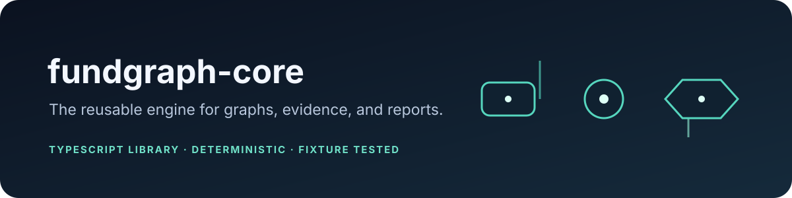

<p align="center"></p>

<p align="center">
  <a href="LICENSE"></a>
  
  
</p>

# fundgraph-core

The reusable TypeScript library behind FundGraph's funding-evidence analysis. Core owns dependency discovery as the
input boundary, versioned models, provenance-bearing metadata and funding parsers, relationship resolution, and
deterministic reports. It contains no terminal UX or payment behavior.

## Package status

Version `0.1.0` was the initial published package baseline. The current package and bounded-registry patch is `0.1.2`. The
project-level mission, roadmap, security policy, and cross-repository decisions are maintained in the separate `fundgraph`
project repository.

## Capabilities

### Local dependency discovery

`discoverDependencies(path)` reads local manifests and lockfiles for:

| Ecosystem | Inputs | Current notes |
|---|---|---|
| npm | `package.json`, `package-lock.json` | Aliases, workspaces, optional dependencies, transitive lockfile edges |
| PyPI | `pyproject.toml`, `requirements.txt`, `poetry.lock` | Optional dependencies and available lockfile edges |
| Cargo | `Cargo.toml`, `Cargo.lock` | Workspaces, optional dependencies, available lockfile edges |
| Go | `go.mod` | Module path and `require` entries; no `go.work`, fetch, or transitive graph expansion |

The reader treats project files as data, enforces size limits, and reports malformed or missing inputs through diagnostics.
It does not run package managers, build tools, or the Go toolchain.

### Metadata and funding evidence

`parseRegistryMetadata` normalizes recorded npm, PyPI, and crates.io payloads. Funding parsers accept package metadata,
GitHub `FUNDING.yml`, and recorded public provider responses. Parsers preserve source, parser, observation timestamp, and
the original bounded response as evidence; they do not make hidden requests. A recorded response is a point-in-time
observation, not a guarantee that the registry or funding declaration is current. Reports expose its timestamp, and users
should refresh network evidence when freshness matters.

Go metadata and funding providers are not implemented.

### End-to-end project analysis

`analyzeProject(path, options)` orchestrates discovery, public registry metadata retrieval, package funding metadata
parsing, relationship resolution, and deterministic reporting. Network access is explicit at the call site and every
retrieved payload is retained as evidence. It supports npm, PyPI, and Cargo metadata providers. Go `go.mod` discovery
is included, but Go metadata and funding providers remain out of scope.

### Relationship and report APIs

`resolveFundingRelationships(input)` emits explicit `supported`, `ambiguous`, `contradictory`, or `unresolved` states
with rule IDs, evidence IDs, and confidence. `createReport(input)` produces a versioned report with stable ordering,
diagnostics, evidence drill-down, limitations, and informational actions. Text output escapes terminal control characters;
JSON output is stable. No action is executed.

### Optional network helpers

`NetworkClient` provides bounded retries, timeouts, cancellation, rate-limit handling, opt-in TTL caching, offline replay,
and partial batch results. Public credential-free HTTPS is the default; private/local destinations and redirects are
rejected. Authenticated requests are not cached. Callers remain responsible for deployment-level DNS/network isolation.

## Minimal usage

```ts
import { discoverDependencies } from '@fundgraph/core';

const result = discoverDependencies('./my-project');
console.log(result.ecosystems);
console.log(result.graph.nodes.map(({ packageId, resolvedVersion }) => ({ packageId, resolvedVersion })));
console.log(result.diagnostics);
```

For a complete public-metadata analysis, call `analyzeProject('./my-project')` with an explicit network policy. For
offline or fixture-driven workflows, use `discoverDependencies` and the pure parser/resolution APIs directly.

## Development

```sh
npm ci
npm run lint
npm run typecheck
npm test
npm run build
npm pack --dry-run
```

The test fixtures live under `test/fixtures/`; the integration matrix is at
[`test/fixtures/integration/fixture-matrix.json`](test/fixtures/integration/fixture-matrix.json). The CI workflow defines
Ubuntu, Windows, and macOS jobs on Node 20 and 22.

## Contributing

See [`CONTRIBUTING.md`](CONTRIBUTING.md). For a new adapter or fixture, follow the `fundgraph` project's adapter guide
and compatibility policy. Keep parsing deterministic and fixture-driven.
